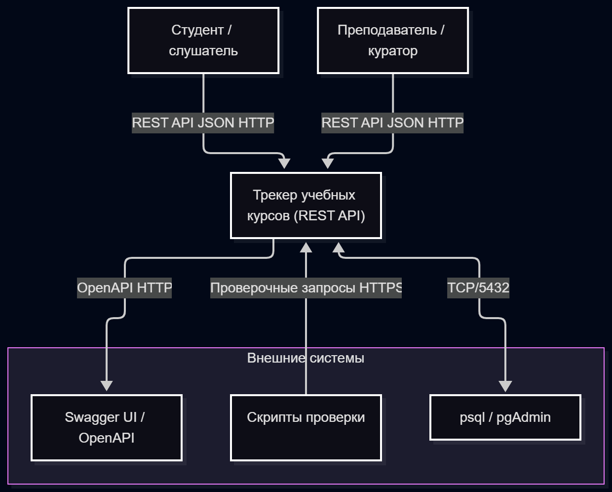
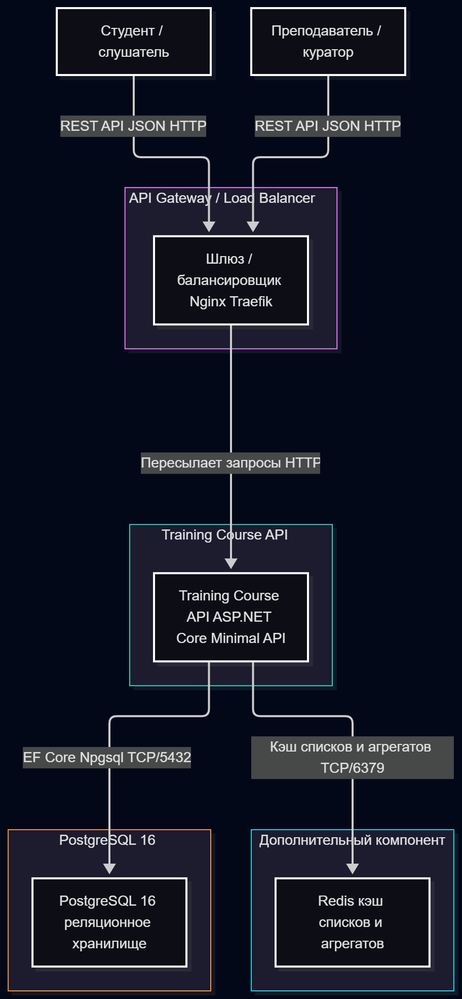
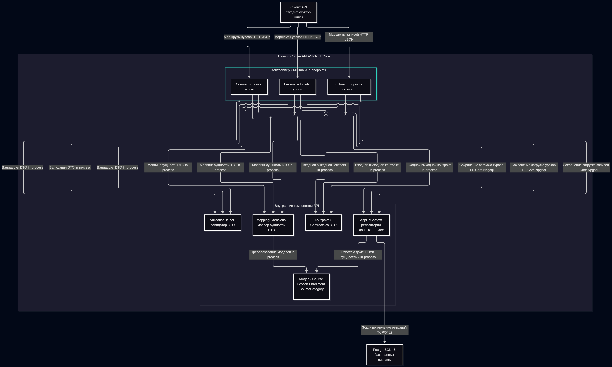

# Training Course Tracker

Микросервисная система отслеживания учебных курсов: каталог курсов, регистрация/вход (JWT), запись на курс и прогресс обучения.

---

## Идея и сценарий

Пользователь открывает сайт, регистрируется/входит, просматривает каталог курсов, записывается на интересующий и отслеживает свой прогресс в личном кабинете.

**Минимальный сценарий:**
1. Открыть `http://localhost:8080` — веб-интерфейс через балансировщик.
2. Зарегистрироваться / войти → получить JWT.
3. Раздел «Курсы» → записаться на курс.
4. Раздел «Мой прогресс» → видеть процент прохождения.

---

## Архитектура (3+ микросервиса)

| Сервис | Папка | Ответственность | Стек |
|--------|-------|-----------------|------|
| **course-service** | `services/course-service/` | Каталог курсов (`GET /api/courses`, `{id}`) | .NET 10, ASP.NET Core, EF Core + PostgreSQL |
| **auth-service** | `services/auth-service/` | Регистрация, логин, JWT | Node.js + Express |
| **progress-service** | `services/progress-service/` | Запись на курс, прогресс уроков | Node.js + Express |
| **web-frontend** | `web-frontend/` | Статический сайт HTML/CSS/JS | Nginx |
| **nginx-lb** | `nginx-lb/` | Балансировщик + reverse proxy на порту 8080 | Nginx |

Все сервисы имеют отдельную папку, API и `Dockerfile`. Взаимодействие через общий балансировщик `nginx-lb`.

---

## C4-Диаграммы

**Level 1 — Context**



**Level 2 — Container**



**Level 3 — Component**



---

## Быстрый старт

Требуются: Docker + Docker Compose.

```bash
# 1. Создать .env (скопировать пример)
cp .env.example .env

# 2. Запустить все сервисы
docker compose up -d --build

# 3. Проверить состояние
docker compose ps
```

Открыть в браузере: `http://localhost:8080`

---

## Настройки (.env)

| Переменная | По умолчанию |
|------------|--------------|
| `POSTGRES_DB` | `coursetracker` |
| `POSTGRES_USER` | `postgres` |
| `POSTGRES_PASSWORD` | (обязательно) |
| `POSTGRES_HOST_PORT` | `5441` |
| `JWT_SECRET` | (обязательно) |

База данных: образ `postgres:16`, данные хранятся в volume `db_data` (сохраняются после перезапуска).

---

## Проверка API (curl)

Через балансировщик `http://localhost:8080`:

```bash
# Список курсов
curl http://localhost:8080/api/courses

# Курс по ID
curl http://localhost:8080/api/courses/1

# Регистрация
curl -X POST http://localhost:8080/api/auth/register \
  -H 'Content-Type: application/json' -d '{"username":"ivan","password":"secret"}'

# Логин (возвращает JWT)
curl -X POST http://localhost:8080/api/auth/login \
  -H 'Content-Type: application/json' -d '{"username":"ivan","password":"secret"}'

# Запись на курс (нужен Bearer-токен)
curl -X POST http://localhost:8080/api/progress/enroll \
  -H 'Content-Type: application/json' -H "Authorization: Bearer <TOKEN>" \
  -d '{"userId":1,"courseId":1}'
```

Подробные примеры: `curl-examples.txt`

---

## Сохранение данных

При `docker compose down` volume `db_data` остаётся — данные в PostgreSQL не теряются. Удаляются только при `docker compose down -v`.

Остановить: `docker compose down`

---

## Технологии

- **Балансировщик:** nginx
- **course-service:** .NET 10, ASP.NET Core Minimal API, EF Core, Npgsql
- **auth-service / progress-service:** Node.js + Express
- **web-frontend:** HTML5, CSS3, vanilla JS
- **База:** PostgreSQL 16 (Docker-образ)
- **Контейнеризация:** Docker + Docker Compose
- **C4-схемы:** `docs/c4-*.png`
