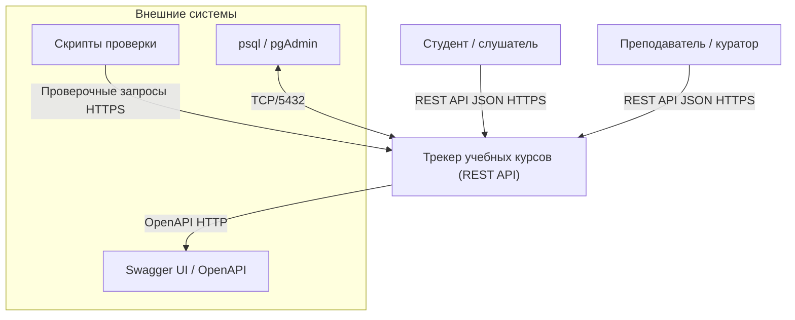
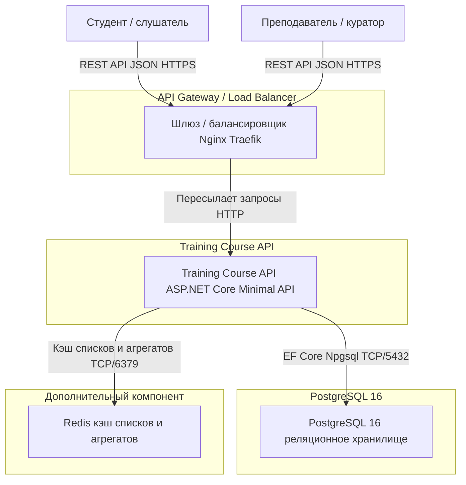
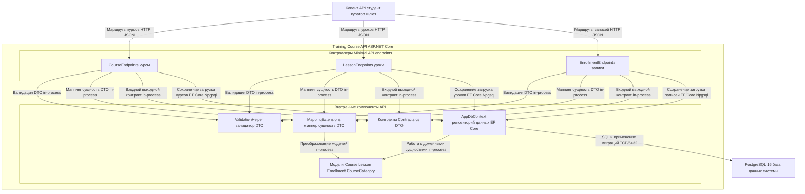

Проблема в тегах `<br>` — GitHub не поддерживает их внутри узлов Mermaid, из-за чего парсер ломается. Ниже — исправленный `architecture.md`, где все диаграммы полностью переwritten на обычный текст без `<br>`. Уровни не смешаны, все подписи простые, стрелки показывают направления.

```markdown
# Трекер учебных курсов — архитектурная документация (C4, Mermaid)

## 1. Описание системы

Трекер учебных курсов — это REST API на ASP.NET Core (.NET 10) для учёта образовательных курсов, уроков и прогресса обучения. Преподаватели и кураторы создают и редактируют курсы и уроки, записывают студентов и следят за их прогрессом и учебными часами; студенты просматривают каталог курсов с фильтрами и пагинацией, записываются на курсы и отслеживают свой прогресс. Данные хранятся в PostgreSQL 16 через Entity Framework Core, приложение разворачивается через Docker Compose и документируется Swagger UI.

---

## 2. Основной пользовательский сценарий

**Сценарий: «Студент выбирает курс и отслеживает свой прогресс обучения»**

1. Студент открывает Swagger UI (или вызывает `GET /api/courses`) и получает список курсов с пагинацией, поиском и фильтрами по категории/активности.
2. Студент открывает карточку курса (`GET /api/courses/{id}`) и видит список уроков и свои записи.
3. Студент записывается на курс (`POST /api/courses/{courseId}/enrollments`) — создаётся запись со статусом `Active` и прогрессом 0 %.
4. По мере прохождения уроков студент обновляет свой прогресс (`PUT /api/courses/{courseId}/enrollments/{enrollmentId}`).
5. Система пересчитывает агрегаты курса (`lessonCount`, `enrollmentCount`, `averageProgress`); при достижении 100 % статус записи меняется на `Completed`.

---

## 3. C4 Level 1 — Context

Система, пользователи и внешние системы. Уровень не смешивается с контейнерами и компонентами.



**Направления взаимодействия:** Студент и Преподаватель → система (REST API, HTTPS); система → Swagger UI (отдаёт спецификацию); Внешние скрипты → система (проверочные HTTP-запросы); Инструмент администрирования БД ↔ данные системы (TCP/5432).

---

## 4. C4 Level 2 — Container

Контейнеры: шлюз/балансировщик, API-сервис, PostgreSQL и дополнительный компонент. Уровень не смешивается с контекстом и компонентами.



**Роли компонентов:**

| Компонент | Роль |
|---|---|
| Студент / Преподаватель | Пользователи системы (люди). |
| API Gateway / Load Balancer | Точка входа: TLS, роутинг, защита от перегрузки (rate limiting). |
| Training Course API | Основной сервис: бизнес-логика, валидация, работа с БД, Swagger, health-check. |
| PostgreSQL 16 | Хранилище данных (курсы, уроки, записи, каскадное удаление, тома для сохранности). |
| Redis (дополнительный) | Кэш часто запрашиваемых списков курсов и агрегированных метрик — снижает нагрузку на БД и ускоряет чтение каталога. |

**Почему выбран именно Redis:** сценарий чтения доминирует (каталог курсов с пагинацией и фильтрами запрашивается гораздо чаще, чем пишется). Распределённый кэш списков и агрегатов (`lessonCount`, `averageProgress`) даёт наибольший отклик при минимальных изменениях: API можно оставить без изменений, добавив слой кэширования перед запросами к EF Core.

> Примечание: текущий `docker-compose.yml` в репозитории содержит только `api` + `db`. Шлюз и кэш показаны как целевые элементы архитектуры уровня 2 — их можно добавить перед API без изменения кода приложения.

---

## 5. C4 Level 3 — Component (контейнер «Training Course API»)

Внутренние части одного сервиса: контроллеры (Endpoints), валидатор, маппер, репозиторий/контекст данных, модели, контракты. Уровень не смешивается с контекстом и контейнерами.



**Роли компонентов (уровень 3):**

| Компонент | Роль |
|---|---|
| CourseEndpoints / LessonEndpoints / EnrollmentEndpoints | Контроллеры Minimal API — принимают HTTP-запросы, вызывают валидацию, маппинг и репозиторий, возвращают ответы. |
| ValidationHelper | Валидация входящих DTO; при ошибке — ответ `400` со списком полей. |
| MappingExtensions | Маппинг между доменными сущностями (EF Core) и DTO контрактов ответов. |
| AppDbContext | Репозиторий доступа к данным: запросы, сохранение, применение миграций EF Core при старте. |
| Модели (Course, Lesson, Enrollment, CourseCategory) | Доменные модели, отображённые на таблицы БД (snake_case). |
| Контракты (Contracts.cs) | DTO запросов и ответов API. |
| PostgreSQL 16 | Хранилище, к которому обращается AppDbContext через Npgsql. |

**Направления:** Клиент → Endpoints → ValidationHelper / MappingExtensions / AppDbContext → PostgreSQL; MappingExtensions ↔ Модели; AppDbContext ↔ Модели.

---

## 6. Исходные схемы и экспорт

**Редактируемый исходник:** три Mermaid-блока выше (уровни 1, 2 и 3) — это и есть исходники схем. Каждый блок расположен в отдельном fence-коде, уровни не смешаны, все подписи простые, стрелки показывают направление взаимодействия.

Рекомендуемые имена файлов для локального хранения исходников:

- `c4-context.mmd` — схема уровня 1 (Context)
- `c4-container.mmd` — схема уровня 2 (Container)
- `c4-component-api.mmd` — схема уровня 3 (Component для API)

**Экспорт в .png / .pdf:**

```bash
# через mermaid-cli
npx @mermaid-js/mmdc -i c4-context.mmd -o c4-context.png
npx @mermaid-js/mmdc -i c4-container.mmd -o c4-container.png
npx @mermaid-js/mmdc -i c4-component-api.mmd -o c4-component-api.png

# или в PDF
npx @mermaid-js/mmdc -i c4-context.mmd -o c4-context.pdf
```

Альтернатива без установки: скопировать код любого блока выше в [mermaid.live](https://mermaid.live) → кнопка «Download PNG/PDF». Также любую IDE с плагином Mermaid (VS Code, IntelliJ и др.) можно использовать для просмотра и экспорта.
```
