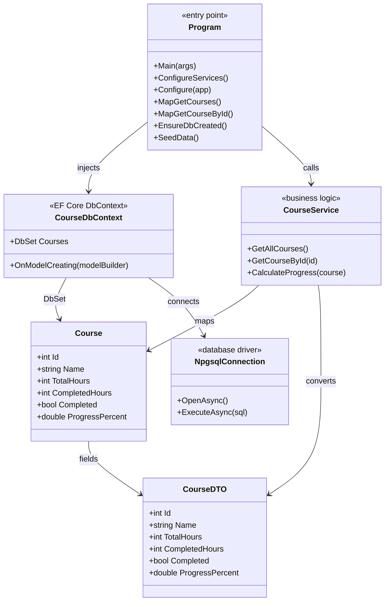

# C4 Level 4 — Code (Код Course Service)

Внутренняя структура компонента **Course Service** (.NET 10, ASP.NET Core Minimal API).

**Связи:**
- `Program` — точка входа, настраивает DI, подключает EF Core, регистрирует Minimal API эндпоинты.
- `CourseDbContext` — контекст базы данных, таблица `Courses`.
- `Course` — доменная модель курса с вычисляемым свойством `ProgressPercent`.
- `CourseService` — бизнес-логика: получение курсов, расчёт прогресса.
- `CourseDTO` — объект передачи данных для API-ответа.
- `NpgsqlConnection` — драйвер PostgreSQL, выполняет SQL-запросы.
